**Proyecto Construye tu propio Sistema Operativo Linux Parte 1: Kernel y
arranque mínimo**

**Kevin Andres Usama Trespalacios**

**Código estudiantil: 240220241001**

**Sistemas Operativos**

**Grupo A**

**6/11/2026**

**Nota:** Al iniciar la guia, empecé a ejecutar los comandos iniciales
usando el equipo 03, pensando que se tenía que hacer el ejercicio con
ese mismo código, cuando avanzaba en la guia, mis compañeros me
comentaron que ese código de equipo debía ser del codigo estudiantil,
pero ya tenía una buena parte avanzada con el taller, por si ve que uso
el equipo 03 pero mi código estudiantil termina en 01 es por esa la
razón profesor.

**Link de milinux en Github:**

[**[https://github.com/kevinA2208/milinux-kernel-pt1-usama]{.underline}**](https://github.com/kevinA2208/milinux-kernel-pt1-usama)

**Crear la estructura de carpetas:**

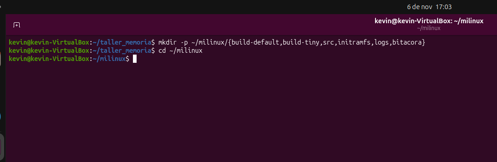{width="6.267716535433071in"
height="2.0555555555555554in"}

**Descargar las fuentes del kernel:**

**Número de parche kernel: longterm 6.18.62**

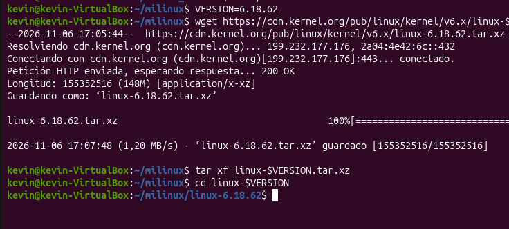{width="6.267716535433071in"
height="2.8333333333333335in"}

**Configurar con defconfig y marcar el kernel con su equipo**

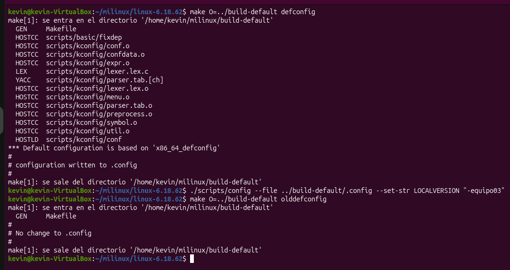{width="6.267716535433071in"
height="3.3194444444444446in"}

**Compilar y medir el tiempo:**

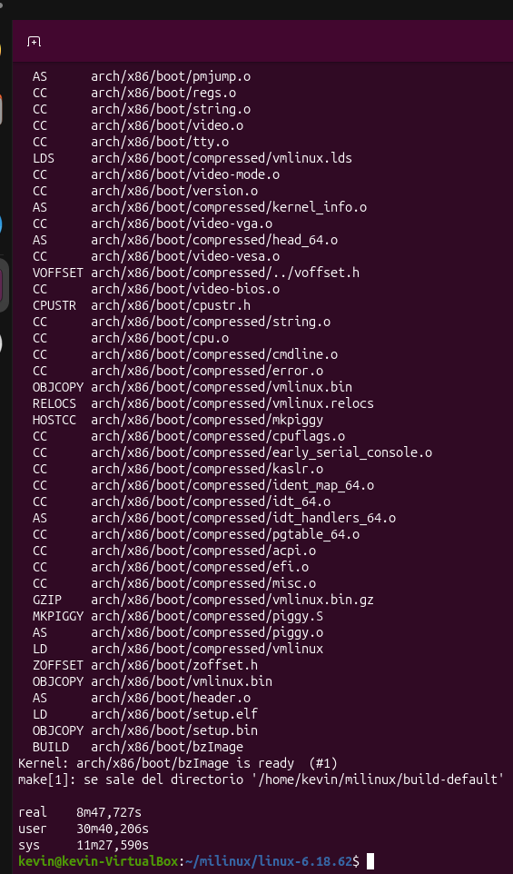{width="5.822916666666667in"
height="4.237396106736658in"}

**real = 8m47,727s = 8 minutos y 47 segundos**

**Verificar el resultado:**

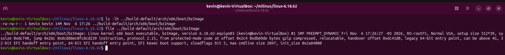{width="6.267716535433071in"
height="0.6944444444444444in"}

**Resultado:**

kevin@kevin-VirtualBox:\~/milinux/linux-6.18.62\$ file
../build-default/arch/x86/boot/bzImage

../build-default/arch/x86/boot/bzImage: Linux kernel x86 boot
executable, bzImage, version 6.18.62-equipo03 (kevin@kevin-VirtualBox)
#1 SMP PREEMPT_DYNAMIC Fri Nov 6 17:26:27 -05 2026, RO-rootFS, Normal
VGA, setup size 512\*39, syssize 0xdc740, jump 0x26c 0x8cd88ec0fc8cd239
instruction, protocol 2.15, from protected-mode code at offset 0x2c4
0xdb69de bytes gzip compressed, relocatable, handover offset 0xdc41d0,
legacy 64-bit entry point, can be above 4G, 32-bit EFI handoff entry
point, 64-bit EFI handoff entry point, EFI kexec boot support,
xloadflags bit 5, max cmdline size 2047, init_size 0x2a84000

**Evidencia E1:**

**RAM VM: 6 GB, CPU: 6**

**Actividad 1. Explorar la configuración del kernel**

**P1. En *General setup → Local version*, ¿qué valor aparece? ¿Dónde lo
vio antes?**

**R//**

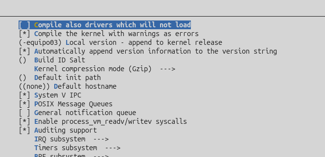{width="6.267716535433071in"
height="3.0416666666666665in"}

(-equipo03) Local version - append to kernel release

Es el sufijo de la versión de mi equipo, aparece al utilizar el comando
./scripts/config

**P2. En *Processor type and features*, ¿cuál es el número máximo de CPU
que soporta este kernel?**

**R//**

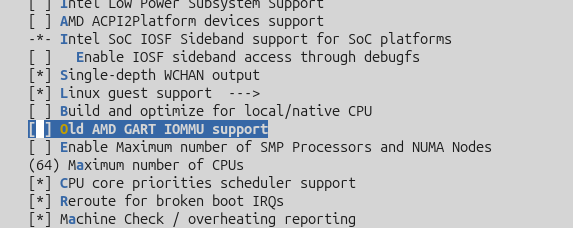{width="5.96875in" height="2.375in"}

El kernel soporta 64 CPUs.

**P3. En *File systems*, ¿ext4 está marcado con \[\*\] o con \<M\>?
Explique qué cambiaría si fuera módulo y el disco raíz usara ext4.**\
\
Navegue con las flechas, Enter para entrar a un menú y / para buscar una
opción por nombre. En la configuración, \[\*\] significa compilado
dentro del kernel, \<M\> compilado como módulo aparte y \[ \] no
compilado. Al terminar salga **sin guardar cambios**.

**R//**

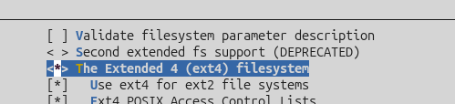{width="5.197916666666667in"
height="1.1875in"}

En File Systems, ext4 está marcado con \< \* \> y no con \<M\>, lo que
significa que está seleccionado como integrado dentro del núcleo del
kernel, si estuviera configurado como un módulo (\<M\>), el controlador
necesario para leer particiones ext4 no estaría disponible de manera
nativa durante la fase inicial del arranque. Por lo que si el disco raíz
utilizara el sistema de archivos ext4, el kernel sería totalmente
incapaz de montarlo por sí mismo.

**P4. Busque con / las opciones BLK_DEV_INITRD y SERIAL_8250_CONSOLE.
¿En qué menú están y qué valor tienen? ¿Para qué las necesitará el
proyecto?**

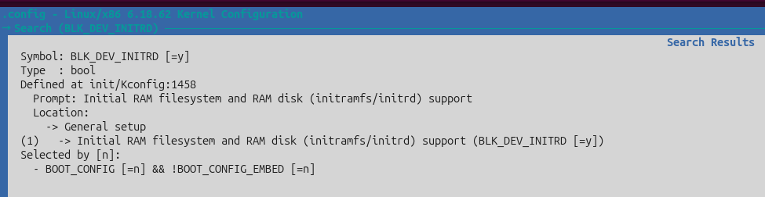{width="6.267716535433071in"
height="1.625in"}

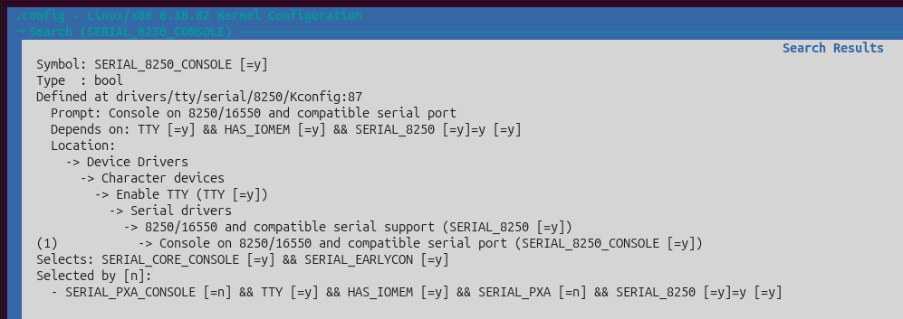{width="6.267716535433071in"
height="2.2222222222222223in"}

El menú en donde esta BLK_DEV_INITRD es General setup, el menú de
SERIAL_8250_CONSOLE es Device Drivers -\> Character devices -\> Enable
TTY -\> Serial drivers -\> 8250/16550 and compatible serial support. El
valor de ambos es =y, ósea que están activados e integrados en el
kernel.

El BLK_DEV_INITRD permite que el kernel sea capaz de descomprimir y
cargar el sistema de archivos temporal en la memoria RAM (initramfs) al
arrancar.

El SERIAL_8250_CONSOLE habilita el uso del puerto serie como consola del
sistema, lo cual es indispensable para que QEMU pueda redirigir y
mostrar todos los mensajes de texto del núcleo directamente en la
terminal de comandos usando la opción -nographic.

**P5. Cuente cuántas opciones quedaron dentro del kernel y cuántas como
módulo:**

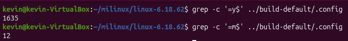{width="6.267716535433071in"
height="0.75in"}Quedaron 1635 opciones dentro del kernel y 12 como
módulo.

**Actividad 2. Lanzar la compilación de tinyconfig**

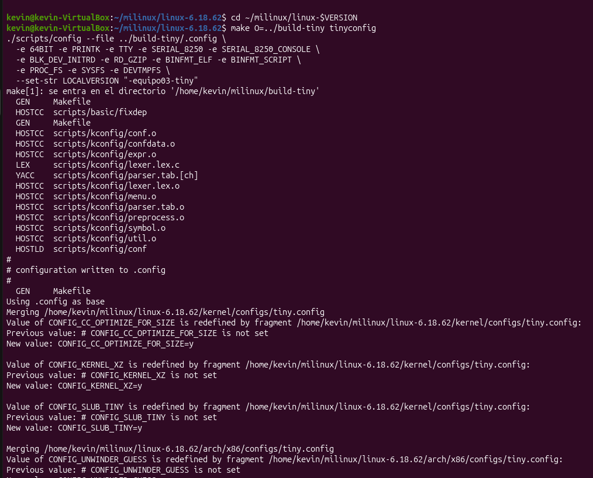{width="6.267716535433071in"
height="5.055555555555555in"}

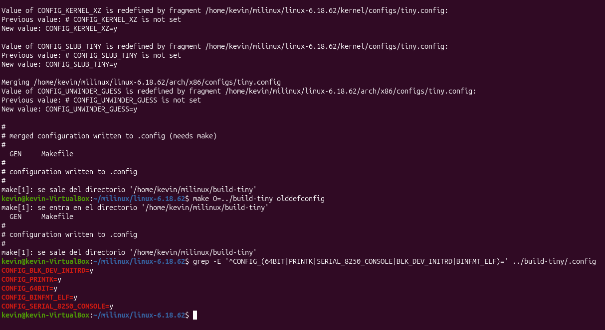{width="6.267716535433071in"
height="3.4305555555555554in"}

**Las 5 opciones están en y.**

**Compilacion: time make O=../build-tiny -j\$(nproc) 2\>&1 \| tee
../logs/build-tiny.log**

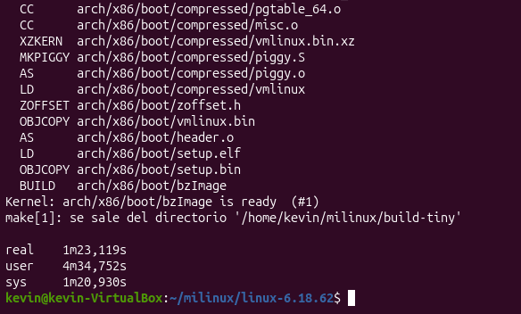{width="6.083333333333333in"
height="3.6666666666666665in"}

**Actividad 3. Arrancar el kernel sin espacio de usuario**

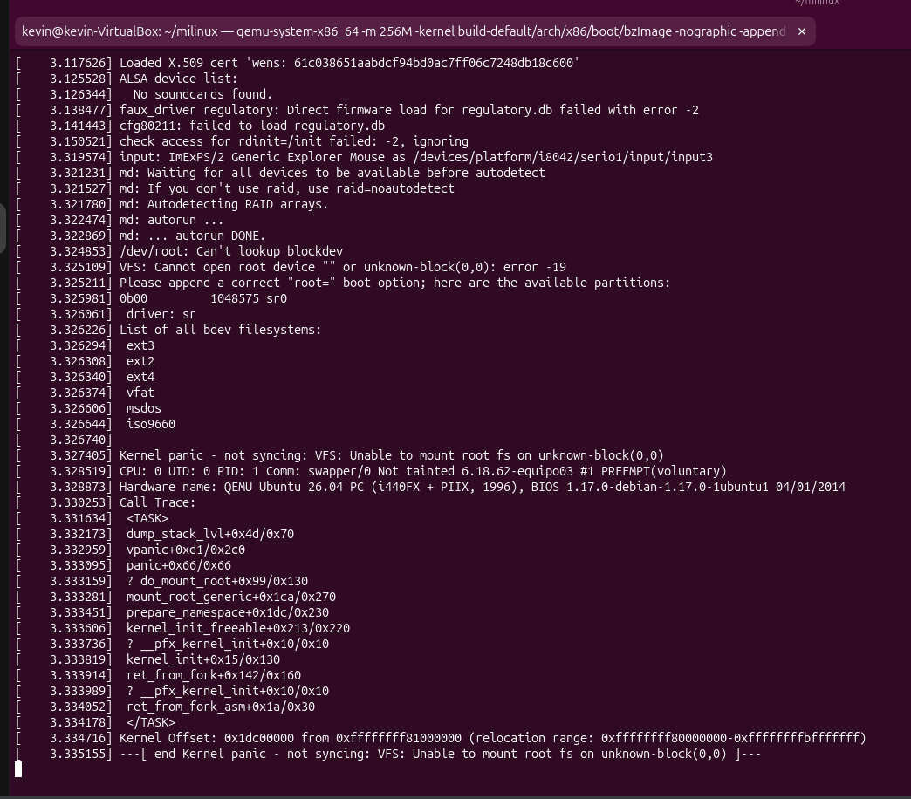{width="6.267716535433071in"
height="5.5in"}

**P6. Copie la línea Linux version \..., la línea Command line: \... y
la línea Memory: \.... Explique qué informa cada una.**

**R//**

**Linux version:** \[ 0.000000\] Linux version 6.18.62-equipo03
(kevin@kevin-VirtualBox) (gcc (Ubuntu 15.2.0-16ubuntu1) 15.2.0, GNU ld
(GNU Binutils for Ubuntu) 2.46) #1 SMP PREEMPT_DYNAMIC Fri Nov 6
17:26:27 -05 2026

**Command Line:** \[ 0.000000\] Command line: console=ttyS0

**Memory:** \[ 0.627267\] Memory: 213060K/261624K available (19092K
kernel code, 2907K rwdata, 7600K rodata, 2824K init, 900K bss, 46352K
reserved, 0K cma-reserved)

**P7. El kernel arrancó y reconoció el hardware. Entonces, ¿por qué se
detiene? Explique qué estaba buscando y no encontró.**

**R//**

El kernel se detiene porque aunque inicializó exitosamente el
procesador, la memoria y los dispositivos, no se le proporcionó ningún
disco de almacenamiento ni un sistema de archivos raíz. Estaba buscando
una unidad o un initramfs válido para montar la raíz, y al no hallarlo
genera el error VFS: Unable to mount root fs on unknown-block(0,0) que
fuerza el Kernel panic para proteger el sistema.

**P8. ¿Un kernel solo, sin ningún programa de usuario, es un sistema
operativo usable? Justifique con lo observado.**

**R//**

No, un kernel por sí solo no es un sistema operativo funcional ni
usable. El núcleo actúa únicamente como la capa de administración y
control del hardware, pero al no tener un programa en el espacio de
usuario que reciba el control, el sistema no puede realizar ninguna
tarea y colapsa de inmediato.

**Actividad 4. Escribir el primer proceso del sistema**

**4.2 Compilar de forma estática. El initramfs no tiene bibliotecas, así
que el programa debe llevarlas dentro:**

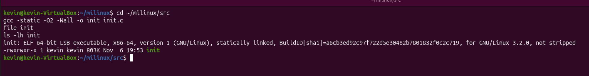{width="6.267716535433071in"
height="0.8055555555555556in"}

**4.3 Armar el initramfs. El archivo se arma desde dentro de la carpeta,
para que init quede en la raíz del archivo:**

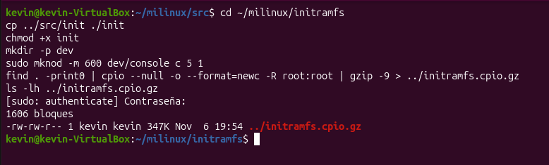{width="6.267716535433071in"
height="1.8888888888888888in"}

**Arrancar con su initramfs.**

**Programa con rol PID 1:**

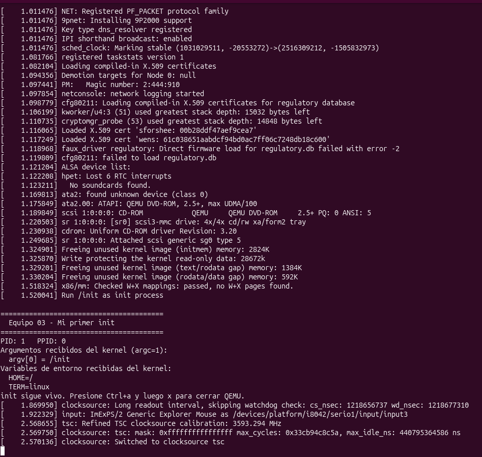{width="6.267716535433071in"
height="5.944444444444445in"}

**Pasar parámetros desde la línea de comandos. Repita el arranque
cambiando solo -append:**

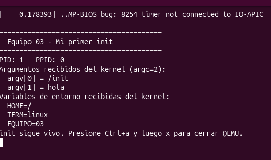{width="5.552083333333333in"
height="3.28125in"}

**P9. ¿Qué PID y qué PPID tiene su programa? ¿Por qué el PPID es 0, si
en Linux todo proceso tiene un padre?**

**R//**

El programa se ejecuta con PID: 1 y PPID: 0. El PPID es 0 porque este
binario es el primer proceso de usuario lanzado directamente por el
kernel de Linux al arrancar el sistema, por lo que no cuenta con un
proceso padre tradicional en el espacio de usuario, el identificador 0
muestra que proviene directamente de la inicialización raíz del núcleo.

**P10. ¿Por qué el programa se compiló con -static? Prediga qué pasaría
sin esa opción (lo comprobarán en la Parte 3).**

**R//**

El programa se compiló con la opción -static para empaquetar e incluir
todas las bibliotecas de C necesarias directamente dentro del propio
archivo binario. Si no se hubiera utilizado -static, el programa
dinámico requeriría un enlazador dinámico externo y bibliotecas
compartidas en el sistema de archivos.

**P11. En el arranque de 4.5, ¿qué parámetros llegaron como argv, cuáles
como variables de entorno y cuáles no llegaron? Busque en el log la
línea Unknown kernel command line parameters y explique la regla que usa
el kernel.**

**R//**

De acuerdo con la salida obtenida, como argumentos del vector argv
llegaron argv\[0\] = /init y argv\[1\] = hola, en las variables de
entorno se recibieron HOME=/, TERM=linux y EQUIPO=03. El parámetro quiet
no llegó al espacio de usuario ni al programa, ya que fue interceptado y
procesado de manera interna en las fases tempranas del arranque.

**P12. Compare la cantidad de mensajes con y sin quiet. ¿Quién consumió
ese parámetro?**

**R//**

Al arrancar con el parámetro quiet, la cantidad de mensajes de
diagnóstico impresos en la consola por el núcleo disminuye
considerablemente, ya que oculta los avisos rutinarios de inicialización
de controladores. Este parámetro fue consumido directamente por el
kernel de Linux para suprimir la cantidad que se muestra de funciones de
registro durante el proceso de arranque.

**Actividad 5. Matar a PID 1 y comparar los dos kernels**

5.1 ¿Qué pasa si PID 1 termina? El parámetro **salir hace que su init
termine con return 0:**

**Segundo Kernel panic:**

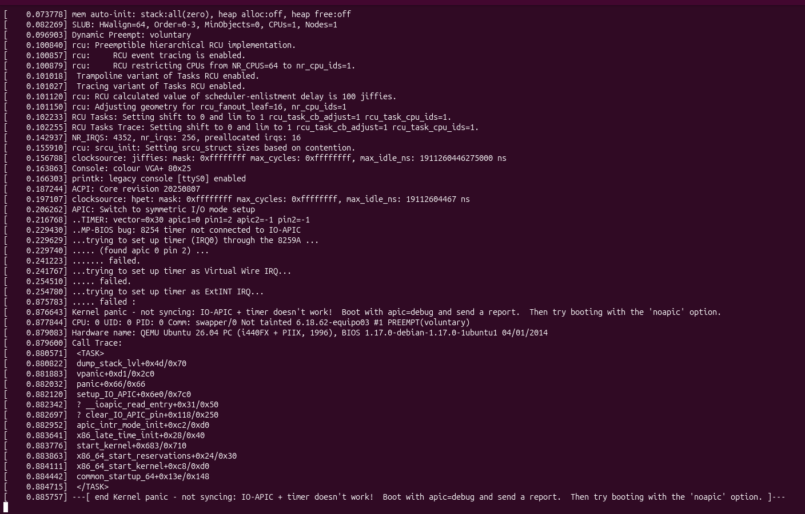{width="6.267716535433071in"
height="4.013888888888889in"}

5.2 Medir los dos kernels. Cuando la compilación de **tinyconfig haya
terminado, arranque ambos kernels con el parámetro medir. Su init
reinicia la máquina apenas termina de imprimir, y la opción -no-reboot
hace que QEMU se cierre en lugar de reiniciar. Así, time mide el
arranque completo hasta PID 1.**

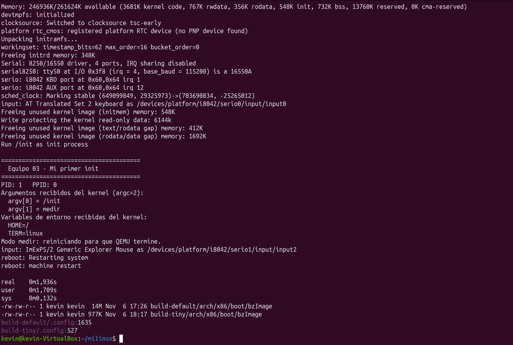{width="6.267716535433071in"
height="4.222222222222222in"}

**Time resultante:** real 0m1,936s

  -----------------------------------------------------------------------
  Medida                  defconfig               tinyconfig
  ----------------------- ----------------------- -----------------------
  Tamaño de bzImage (MB)  14 MB                   977 KB

  Opciones dentro del     1635                    527
  kernel (=y)                                     

  Tiempo de compilación   8 m 47 segundos         1 m 23 segundos
  (real, min)                                     

  Tiempo de arranque      1,52 segundos           0,30 segundos
  hasta PID 1 (s,                                 aproximado
  mediana)                                        

  Memoria disponible      213060 KB               246936 KB
  (línea Memory:, KB)                             
  -----------------------------------------------------------------------

**P13. Compare el mensaje de *panic* de 5.1 con el de la Actividad 3.
¿Qué falló en cada caso y por qué el kernel no puede continuar sin PID
1?**

**R//**

Cuando el proceso init (PID 1) finaliza su ejecución de forma anticipada
mediante un return, el núcleo de Linux detecta que el proceso raíz y
principal del espacio de usuario ha muerto. Dado que el sistema
operativo no puede operar ni mantener servicios estables sin un proceso
PID 1 activo, el kernel reacciona generando un Kernel Panic inmediato
bajo el mensaje de error Attempted to kill init!, forzando la detención
del sistema para proteger el equipo.

**P14. Explique las diferencias de la tabla a partir de lo que cada
configuración incluye.**

**R//**

El kernel tinyconfig compila 3 veces menos opciones que defconfig (527
vs 1635), lo que reduce drásticamente el tamaño del ejecutable bzImage
(de 14 MB a 977 KB) y el tiempo de compilación (de casi 9 min a 1.3
min). Al no cargar controladores pesados ni subsistemas de red o discos,
tinyconfig arranca mucho más rápido y deja libre más memoria RAM para
los procesos de usuario (246.9 MB libres frente a 213.0 MB de defconfig)

**P15. El proyecto continúa con el kernel defconfig. Nombre tres
capacidades que tinyconfig no tiene y que se necesitarán en las partes
siguientes (pista: disco, sistema de archivos ext4 y red).**

**R//**

\- Controladores de almacenamiento (Block Devices/SATA/IDE): tinyconfig
no incluye soporte para discos físicos o virtuales, lo que impide
detectar unidades de estado sólido o discos duros.

\- Sistemas de archivos (ext4/vfat): Carece de soporte integrado para
leer y montar sistemas de archivos reales como ext4, limitándose
únicamente a montar imágenes en memoria RAM (*initramfs*).

\- Pila de red (TCP/IP y controladores Ethernet): No incluye la pila de
protocolos de red ni los drivers de interfaz, impidiendo la comunicación
o conexión a red del sistema.
